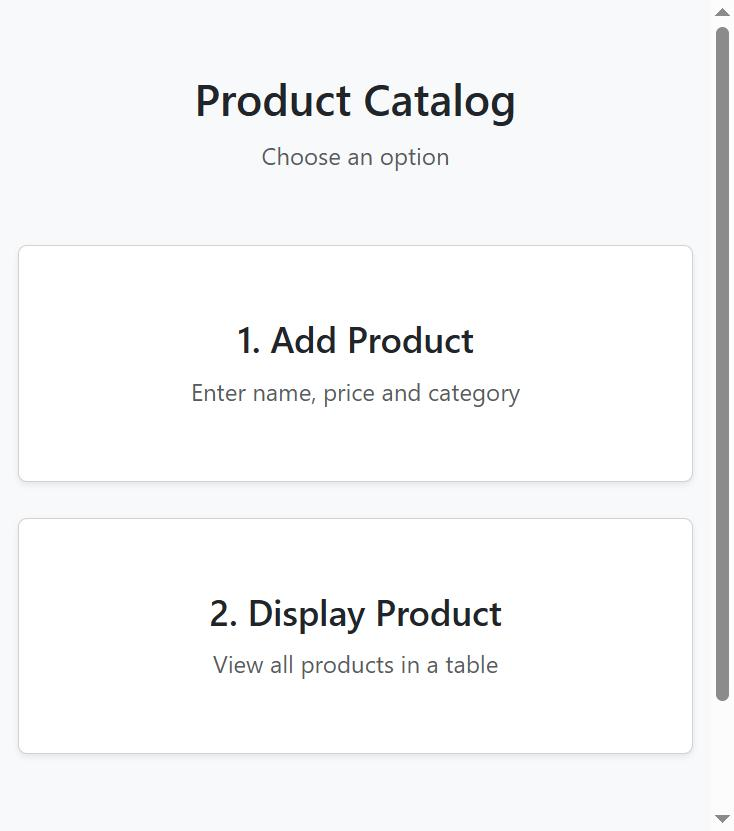
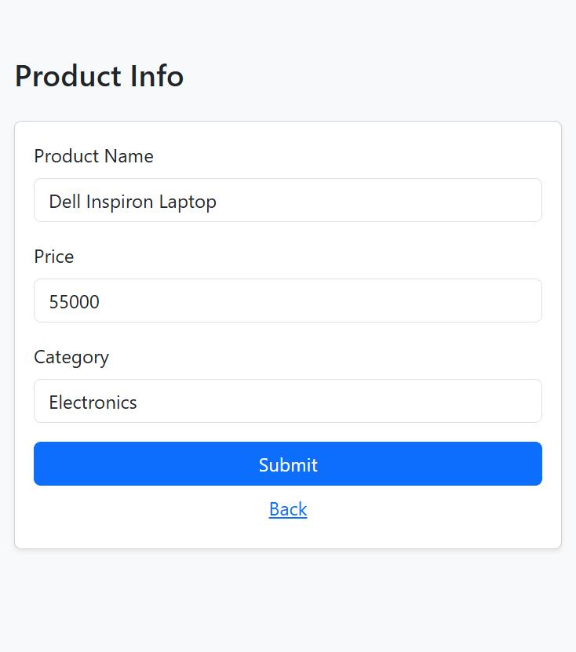
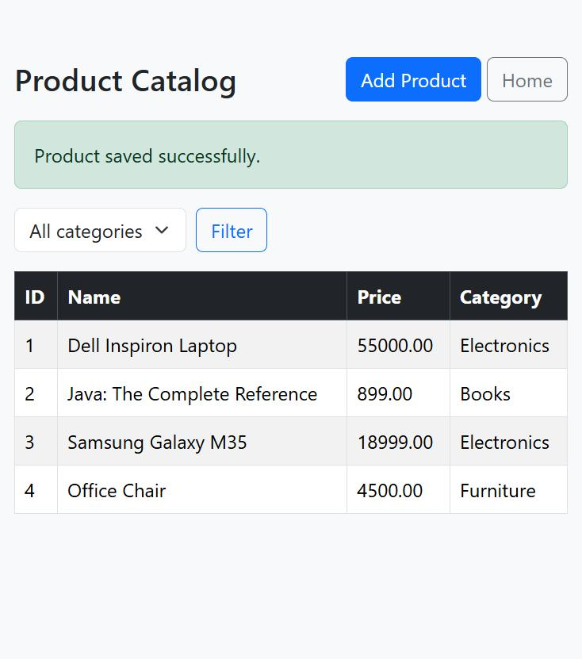
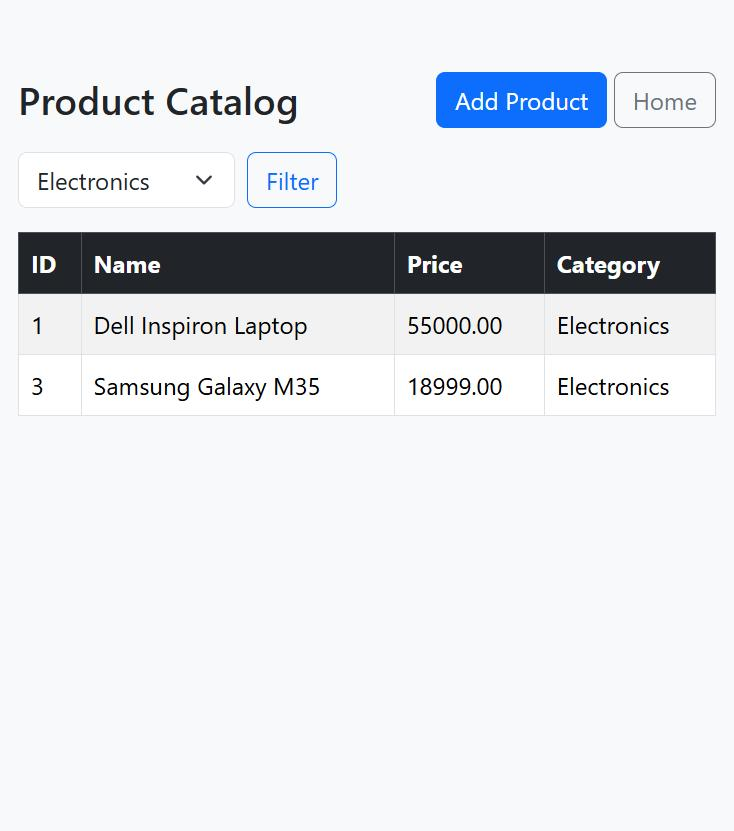
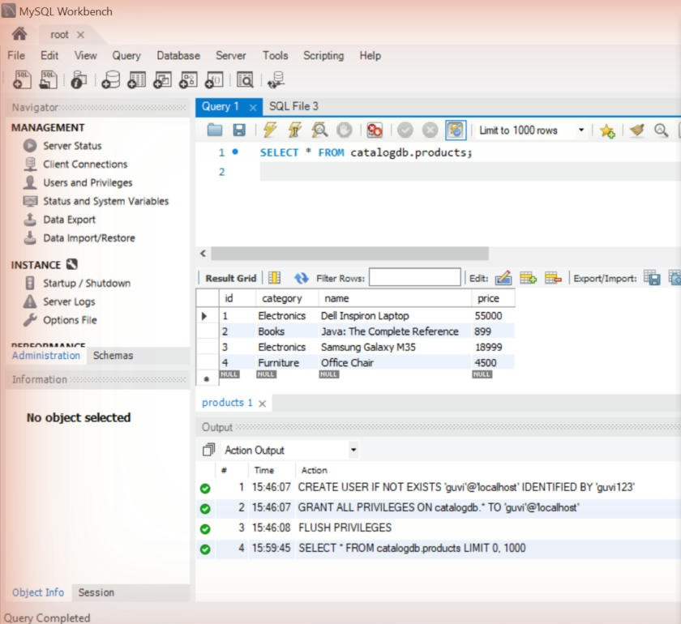
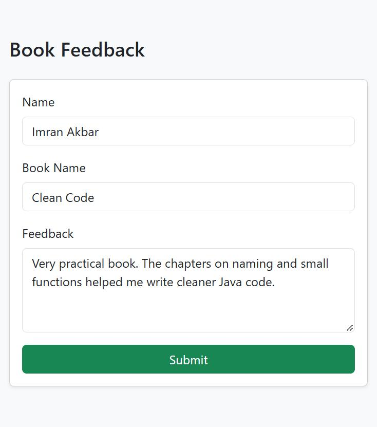
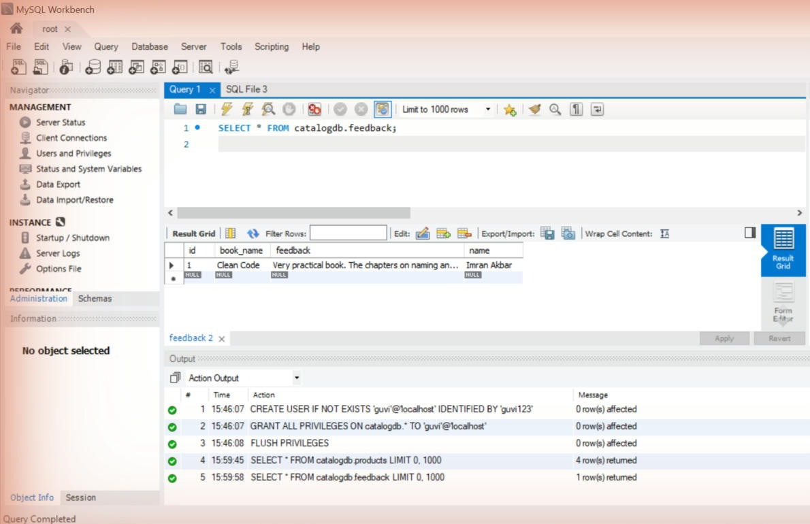
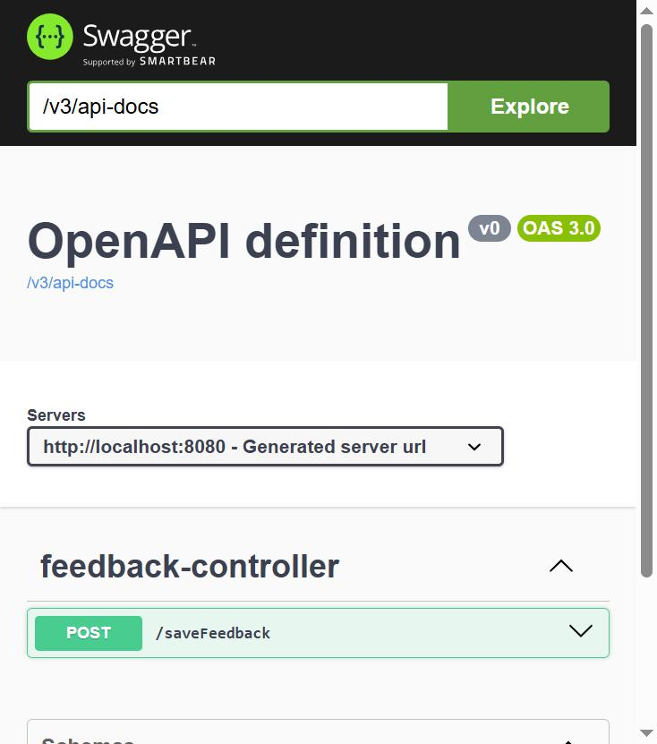

# Spring Boot MVC – Product Catalog & Feedback (Thymeleaf + MySQL)

## Q1. Product Catalog
- `GET /` – Home page with two options: **1. Add Product** and **2. Display Product**
- `GET /products/add` – Product info form (name, price, category)
- `POST /products/save` – Saves the product to MySQL using Spring Data JPA
- `GET /products` – Displays all products in a table
- `GET /products?category=Electronics` – Products of one category  
  (repository method: `findByCategoryIgnoreCase(String category)`)

## Q2. Feedback Application
- `GET /feedback` – Feedback form (Name, Book Name, Feedback)
- `POST /saveFeedback` – Saves to MySQL and responds with **`feedback saved!`**

## Tech stack
Spring Boot 3 · Spring MVC · Thymeleaf · Spring Data JPA · MySQL · Bootstrap

## Run
1. Start MySQL and run `mysql/create_user.sql` once as root (or edit `src/main/resources/application.properties`)
   (the `catalogdb` database is created automatically).
2. `mvn spring-boot:run`
3. Open http://localhost:8080/ and http://localhost:8080/feedback
4. Swagger UI: http://localhost:8080/swagger-ui.html

## Project structure
```
model/Product, model/Feedback            -> JPA entities
repository/ProductRepository             -> JpaRepository + findByCategoryIgnoreCase
repository/FeedbackRepository            -> JpaRepository<Feedback, Long>
service/ProductService, FeedbackService  -> business logic
controller/ProductController             -> catalog pages
controller/FeedbackController            -> GET /feedback, POST /saveFeedback
templates/                               -> Thymeleaf pages
```

## Screenshots (run on Spring Tools for Eclipse 5.0.1, MySQL 8.0.46)

### Q1 – Product Catalog
| Step | Screenshot |
|---|---|
| Home page – 1. Add Product / 2. Display Product (`GET /`) |  |
| Product info form (`GET /products/add`) |  |
| All products in a table (`GET /products`) |  |
| Products of one category (`GET /products?category=Electronics`) |  |
| MySQL `catalogdb.products` table |  |

### Q2 – Feedback Application
| Step | Screenshot |
|---|---|
| Feedback form (`GET /feedback`) |  |
| Response after submit (`POST /saveFeedback`) |  |
| MySQL `catalogdb.feedback` table |  |

### Swagger UI


## Database user
The app connects with a local test user. Create it once as root in MySQL Workbench using `mysql/create_user.sql`, or change the username/password in `application.properties`.
